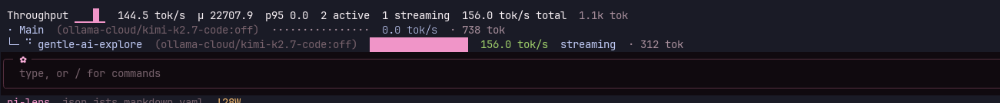

# tps-gentle-pi

A live tokens-per-second (TPS) meter for the [Pi coding agent](https://pi.dev) and
[Gentle Shell](https://github.com/Gentleman-Programming/gentle-shell), the Pi
distribution that runs gentle-pi as its launcher. It draws a compact two-part
panel above the editor: a **header line** with the turn sparkline, last rate, mean
(`μ`), P² p95, participant counts, and panel-wide rate and token totals, plus one
**row per participant** — the main agent and each
[gentle-pi](https://www.npmjs.com/package/gentle-pi) subagent whose live
correlation evidence is deterministic. It is a zero-build TypeScript package: its
suite runs the sources directly on Node 24, and nothing is compiled.

> **Answer:** the meter works on **vanilla Pi** (no gentle-pi) with zero
> subagent rows, on Pi with gentle-pi, and inside Gentle Shell — the isolated,
> `--link` and `--home` homes all declare and discover the same package. Every
> optional path degrades silently: a channel or aggregation failure never
> disables the main meter.

## Quick path

Install it into the home that will load it. `tps-gentle-pi` is an ordinary Pi
package, so Gentle Shell runs Pi's own `install` against its selected home:

```sh
# Gentle Shell, configured home (isolated ~/.gentle-shell/agent by default)
gentle-shell install npm:tps-gentle-pi

# Gentle Shell, one explicit home (one selector, before the subcommand)
gentle-shell --isolated install npm:tps-gentle-pi
gentle-shell --link install npm:tps-gentle-pi
#   ^ reuse your own Pi agent home
gentle-shell --home /absolute/agent/home install npm:tps-gentle-pi
```

Pi, with or without gentle-pi, is unchanged:

```sh
pi install npm:tps-gentle-pi
```

Then start a TUI session in Pi or in `gentle-shell` and stream a response. The
panel appears above the editor; confirm that the header aggregates (sparkline,
`μ`, `p95`, totals) and the main row gauge and `tok/s` update while output
streams. `gentle-shell list` or `pi list` shows the package once per home, with no
global npm install needed: Pi discovers the extension through the package's
`pi.extensions` manifest.

A one-off `pi -e /path/to/tps-gentle-pi/extensions/index.ts` (or an extra `-e` passed
through `gentle-shell`) starts the meter in that parent process only; [Child
visibility](#child-visibility) explains how installed packages reach children.

## What it looks like

The panel sits above the editor while a response streams. It has two parts: a
**header line** with the session-wide aggregates, then one **row per participant**
(the main agent plus every live subagent).

```text
Throughput ▂▃▄▅▄▅▆▆▇▇██  58.0 tok/s  μ 38.2  p95 51.0  3 active  1 streaming  84.6 tok/s total  14.6k tok
· Main  (anthropic/claude-3-7-sonnet:high)  ████▌···········  42.5 tok/s  · 12.3k tok
├─ ⠋ scout  (anthropic/claude-3-5-haiku)  ██▋·············  24.1 tok/s  tool: read  · 1.4k tok
└─ ⠋ worker  (anthropic/claude-3-5-haiku:low)  █▉··············  18.0 tok/s  streaming  · 820 tok
```

| Part | Fields, left to right. Trailing fields drop on narrow terminals. |
| --- | --- |
| Header | `Throughput` + 12-turn sparkline, last `tok/s`, `μ`, `p95`, `N active`, `N streaming`, panel `tok/s total`, total `tok` |
| Main row | phase icon, `Main` (or `Main [tool: x]`), `provider/id:thinking` at standard and wide, hybrid gauge, `tok/s`, `· N tok` at standard and wide |
| Subagent row (live) | tree glyph + phase icon, raw correlated agent name or honest `subagent` / `subagent · <pid>` fallback, `provider/id:thinking` at standard and wide, hybrid gauge, `tok/s`, phase/tool state, `· N tok` at standard and wide |
| Subagent row (completed) | `✓`, honest `subagent` / `subagent · <pid>` fallback name, `provider/id:thinking` at standard and wide, `wall avg N tok/s`, `· N tok` |

The gauge is **hybrid**: the denominator is `max(fastest live row, 150)` tok/s. While
every participant stays below 150 tok/s, each bar is an absolute magnitude reading on
the fixed 150 tok/s scale, so a quiet panel never looks busy. As soon as one
participant exceeds 150 tok/s, the fastest row fills the bar and the rest compare
against it, so the panel keeps showing relative shape at high speed. Task titles are
intentionally never displayed: a live worker row is named by the raw correlated agent
name, or by the honest fallback when correlation is ambiguous. A worker that finishes
stays visible as a `✓` row for 10 seconds (`COMPLETED_PERSIST_MS`) before the
parent evicts and unlinks its snapshot: it drops the gauge and reports its
wall-clock average instead of a live rate. A run that resumes inside that window
reopens the same row. The header aggregates derive only from the
tracker and the live rows — nothing is fabricated.


*Main meter: gauge, live `tok/s`, 12-turn sparkline, `μ`, and `p95`.*



*Main meter with one active gentle-pi subagent row while the worker streams.*

## How it works

| Area | Decision |
| --- | --- |
| Main meter | Live TPS from output deltas since the first delta, preferring provider-reported usage and falling back to a `ceil(chars / 4)` estimate. Authoritative usage is recorded at message end and pushed into the sparkline, mean, and P² p95. |
| Roles | `session_start` selects `parent-tui` (TUI + no child marker), `gentle-worker` (child marker + inherited channel), or `headless-noop`. |
| Subagent channel | The parent creates one private, unpredictable session directory; each worker publishes a throttled, atomic, schema-validated snapshot. The parent aggregates only live snapshots. |
| Identity | The row name is the raw correlated agent name (`agent`), shown only on the single **live** worker when exactly one worker is live and exactly one task is active. Every other shape — concurrent workers, a worker/task count mismatch, a worker without a task, or a **retained completed row** — uses an honest fallback (`subagent` / `subagent · <pid>`) and never guesses. No public Shell contract exposes a taskId ↔ PID/childSessionId join, so a finished worker's own task name is unknown and is never filled in from currently active work. Task titles are never rendered. |
| Completion | `agent_end` marks the worker complete and writes its terminal row synchronously, so a process exit right after it cannot race the write. A **legacy host need not emit `agent_settled`**, and need not emit more events for that run, so that terminal write is the close there. A later `agent_start` or assistant turn reopens the same worker row with a fresh publisher and no completion stamp, so retries and continuations stay live. `agent_settled` is consumed as the definitive close when the host actually emits it; a host that never does keeps the `agent_end` behavior. Late tool-only transitions never reopen a completed row, and cumulative session tokens carry across runs. A completed row reports `wall avg`, never a live `tok/s`. |

## Metrics semantics

Three different numbers share the panel, so the labels name what each one measures:

| Shown as | Meaning |
| --- | --- |
| `N tok/s` | Live **generation** throughput of the current turn: provider-reported usage when available, otherwise the `ceil(chars / 4)` estimate. |
| `wall avg N tok/s` | Completed rows only: cumulative worker-session output tokens ÷ the worker session's wall-clock lifetime (`startTime` → `completedAt`). It includes idle waits and tool time, so it is **not** a per-task figure and not a pure decode rate. A resumed worker session keeps accumulating, so the value covers every run of that session. |
| last `tok/s`, `μ`, `p95`, `tok/s total` | Header aggregates: the last completed turn's rate, the incremental mean and P² p95 over that turn history, and the live rates summed across participants. |

A completed row with no observed average (for example a terminal snapshot without a
completion timestamp) falls back to its last live rate and keeps the plain `avg`
label, so a wall-clock claim is never fabricated.

## Installation

`tps-gentle-pi` is a Pi package, so it installs the same way everywhere, and every
route ends with a package declaration in one agent home that Pi discovers at
startup:

| Host | Install command | `settings.json` written (declaration) |
| --- | --- | --- |
| Pi, vanilla or with gentle-pi | `pi install npm:tps-gentle-pi` | in Pi's agent home: `~/.pi/agent/settings.json`, or the resolved `PI_CODING_AGENT_DIR` |
| Gentle Shell, isolated home (default) | `gentle-shell install npm:tps-gentle-pi` | in the isolated home: `~/.gentle-shell/agent/settings.json`, or the `GENTLE_SHELL_HOME` override |
| Gentle Shell, `--link` | `gentle-shell --link install npm:tps-gentle-pi` | in your own Pi agent home, resolved through `GENTLE_SHELL_USER_PI_HOME`, then `PI_CODING_AGENT_DIR`, then `~/.pi/agent` |
| Gentle Shell, `--home <dir>` | `gentle-shell --home <dir> install npm:tps-gentle-pi` | in `<dir>/settings.json` |

`gentle-shell install` is Pi's own `install` command pointed at the resolved home,
so `gentle-shell list`, `gentle-shell remove` and `gentle-shell update` address
the same place, and `gentle-shell home` reports the active mode and directory
without changing it. Every route writes the `settings.json` of one **resolved**
home: the launcher derives that home from the selector and your saved choice (a
plain `gentle-shell install` follows the configured home, isolated by default), so
read the resolved path rather than assuming a precedence.

Use a home selector **before** the subcommand, as in the table above. `--isolated`,
`--link` and `--home <path>` are mutually exclusive — `gentle-shell --link
--isolated install ...` exits 2 with `--link cannot be combined with --isolated`,
and the same check covers `--home` — and trailing placement is not a documented
home choice, so do not rely on it.

What you do **not** need:

- **A global npm install.** `npm i -g tps-gentle-pi` is never required; Pi
  discovers the extension through `pi.extensions` in the installed package.
- **A gentle-pi install in the Gentle Shell home.** The launcher supplies its own
  gentle-pi, so a Shell home only has to carry TPS. Installing
  `npm:gentle-pi` into that home as well is unnecessary; update the launcher
  through its own package manager (or `gentle-shell upgrade` in a bundled
  install) instead of managing a second copy there.

Homes are separate stores. Installing TPS in Pi does not put it in the isolated
Gentle Shell home, and `gentle-shell home import-pi` deliberately copies only
sign-ins (`auth.json`), MCP servers (`mcp.json`) and the default model, provider
and thinking level — never `packages`, `extensions` or caches. Install TPS in
each home you actually use, or `--link` the Shell to the Pi home that already has
it.

### Runtime requirements

TPS declares `engines.node >=24.0.0`: it is a zero-build package (no transpiled
output, no build step) and its own suite runs the TypeScript sources natively with
`node --test` on Node 24. Which Node hosts it at runtime is decided by the Pi
runtime the launcher starts, not by the home selector — so check that runtime, and
treat anything below Node 24 as unsupported for this package.

| Gentle Shell install | Which Pi runtime and Node run the extension |
| --- | --- |
| Bundled (`~/.gentle-shell/versions/<id>/`) | the Pi and Node that bundle ships; verify the version that bundled runtime reports instead of assuming a given release pins one Node line |
| `--link` or `--home` (or a global `gentle-pi`) | the Pi runtime the launcher resolves — `GENTLE_SHELL_PI`, a `pi` on `PATH`, or the Pi package next to the launcher — running on whichever Node that runtime uses |

`--isolated`, `--link` and `--home <path>` choose a home, not a Node runtime, so a
selector alone never settles the requirement, and the shell you type
`gentle-shell` into is not necessarily the runtime that hosts the extension. Verify
the Node version behind the resolved Pi runtime. Gentle Shell's own floor
(`engines.node >=22.19.0`) is a launcher requirement, so it does not imply that TPS
loads there.

## Child visibility

Install as a **package in the home the children inherit**. Gentle Agents launches
subagents as isolated `pi --mode rpc` child processes in the same agent home, so a
declaration in that home is discovered in every child. That holds for a Pi home
and for each Gentle Shell home mode above: the launcher passes the resolved home
to Pi through `PI_CODING_AGENT_DIR`/`GENTLE_PI_AGENT_HOME`, and delegated children
inherit it.

A one-off **`-e`** load is not part of any home:
`pi -e /path/to/tps-gentle-pi/extensions/index.ts` (or an extra `-e` passed through
`gentle-shell`) loads the extension in that parent process. Gentle Shell forwards
only its own computed extension set to children, never a pass-through `-e` you
typed, so a parent-only load does not guarantee that children get the extension.
Where a child has not loaded it, that child renders no row: the panel never
fabricates rows for workers that did not publish a snapshot. If the package is also
installed in the home the children inherit, they load it through package discovery
whatever the parent's `-e` did.

## Vanilla Pi and fallback

On vanilla Pi (no gentle-pi installed, no Gentle Agents tools observed), the
extension consumes only the public `ExtensionAPI`/`ExtensionContext` surface
(`pi.on`, `ctx.mode`, `ctx.hasUI`, `ctx.ui`) and never imports gentle-pi at
runtime. The main-agent live TPS, sparkline, mean, and p95 work fully, and zero
subagent rows are rendered.

Every optional subagent path degrades safely: directory creation, publication,
reading, validation, aggregation, or cleanup failures leave subagent rows absent
while the main panel continues updating. No exception escapes to the Pi session.

## Temporary files, privacy, and lifecycle

- The parent creates **one** private session directory under `os.tmpdir()`, named
  `pi-tps-<pid>-<ts>-<random>` and owned by the `.owner` marker
  (`{ pid, created, v: 1 }`).
- On Linux/macOS the directory is mode `0700` and snapshots are mode `0600`; on
  Windows the user's own temp directory and inherited ACLs apply with no POSIX
  modes.
- Snapshot packets contain **only** metric/state fields (identity, model, phase,
  active tool, TPS, token counters, PID, timestamps) — never prompt, task, or
  generated text.
- A child that shuts down without a graceful completion (crash, unexpected
  `session_shutdown`, or a terminal write that failed after its bounded retries)
  unlinks its own snapshot and any residual temp file, so stale live data is never
  rendered as completed.
- A gracefully completed child keeps its terminal snapshot after the publisher
  closes, so a shutdown or process exit right after completion cannot erase it, and
  the parent renders it as the completed `✓` row. That row is a short confirmation,
  not archival state: the parent's snapshot guard evicts and unlinks the file once
  `COMPLETED_PERSIST_MS` (10 s) have passed since `completedAt`, and a completed
  snapshot with no `completedAt` has no window and evicts immediately.
- The parent removes only its own session directory on `session_shutdown`; a
  startup scavenger removes only verified package-owned stale directories
  (`.owner` + dead PID + older than one hour), preserving every foreign or
  markerless directory.
- All metrics are session-scoped and in-memory. There is **no telemetry**, no
  analytics, no network service, and no durable storage; removing the package and
  restarting leaves no residual state.

## Supported platforms

Linux, macOS, and Windows. The channel and tests use only cross-platform Node
APIs (`fs`, `os`, `path`, `process`, timers); no shell commands run on any path.
Run the suite with the Node built-in runner:

```sh
npm test
```

## Package metadata

- Name: `tps-gentle-pi`
- Hosts: Pi (vanilla or with gentle-pi) and Gentle Shell in isolated, `--link` and
  `--home` modes. The extension needs only the Pi ExtensionAPI plus the optional
  gentle-pi correlation channel.
- Node requirement: `>=24.0.0` (`engines.node`). Zero build: the package ships
  TypeScript sources, its suite runs them natively with `node --test` on Node 24,
  and Pi loads the extension through its own extension loader. The Node hosting Pi
  must satisfy this range; Gentle Shell's own `>=22.19.0` floor does not imply it.
- Pi manifest: `pi.extensions = ["./extensions"]` (Pi discovers the extension here)
- Discovery keywords: `pi-package`, `pi-extension`, `throughput`,
  `tokens-per-second`, `tps`, `meter`
- Optional peer dependency: `@earendil-works/pi-coding-agent` with the `"*"` range,
  declared optional via `peerDependenciesMeta`. Pi bundles its core packages, so
  extensions list them as `"*"` peers and never bundle them.
- Release channel: `publishConfig.access` is `public`; releases go through the
  GitHub Actions `publish.yml` workflow with npm provenance.

## Repository

- Source: <https://github.com/glacayo/tps-gentle-pi>
- Issues: <https://github.com/glacayo/tps-gentle-pi/issues>

## Troubleshooting

| Symptom | Cause and fix |
| --- | --- |
| Main meter works, no subagent rows | Load it as an installed package instead of a one-off `-e`: `pi install npm:tps-gentle-pi`, or `gentle-shell install npm:tps-gentle-pi` in the home the Shell loads, so children discover it. A parent-only `-e` does not guarantee child propagation. |
| Rows appear in Pi but not in Gentle Shell | The isolated Shell home (`~/.gentle-shell/agent`) is a separate store; `gentle-shell home import-pi` copies sign-ins and defaults but never packages. Install there too, or use `gentle-shell --link`. |
| The extension does not load in Gentle Shell | Check that the declaration sits in the home the Shell resolves (`gentle-shell home`) and that the Node behind the resolved Pi runtime satisfies `engines.node >=24.0.0`; TPS ships no build output, so older runtimes are unsupported. |
| Panel never appears | Ensure the session is a TUI session (`ctx.mode === "tui"`); headless/RPC sessions are silent by design. |
| Row labels show `subagent · <pid>` | Correlation evidence is ambiguous — concurrent workers, a count mismatch, or a retained completed row that never borrows a live task's name. This is the honest fallback, not a bug. Run only one delegated task to get a badge. |
| Lines look truncated on a narrow terminal | The panel clamps adaptively (wide ≥ 120, standard 80–119, narrow 60). Fields hide deterministically rather than overflowing. |
| `npm test` fails with a module-not-found | Use Node 24 (`node --test` runs `.ts` natively via type stripping); no build step is required. |
